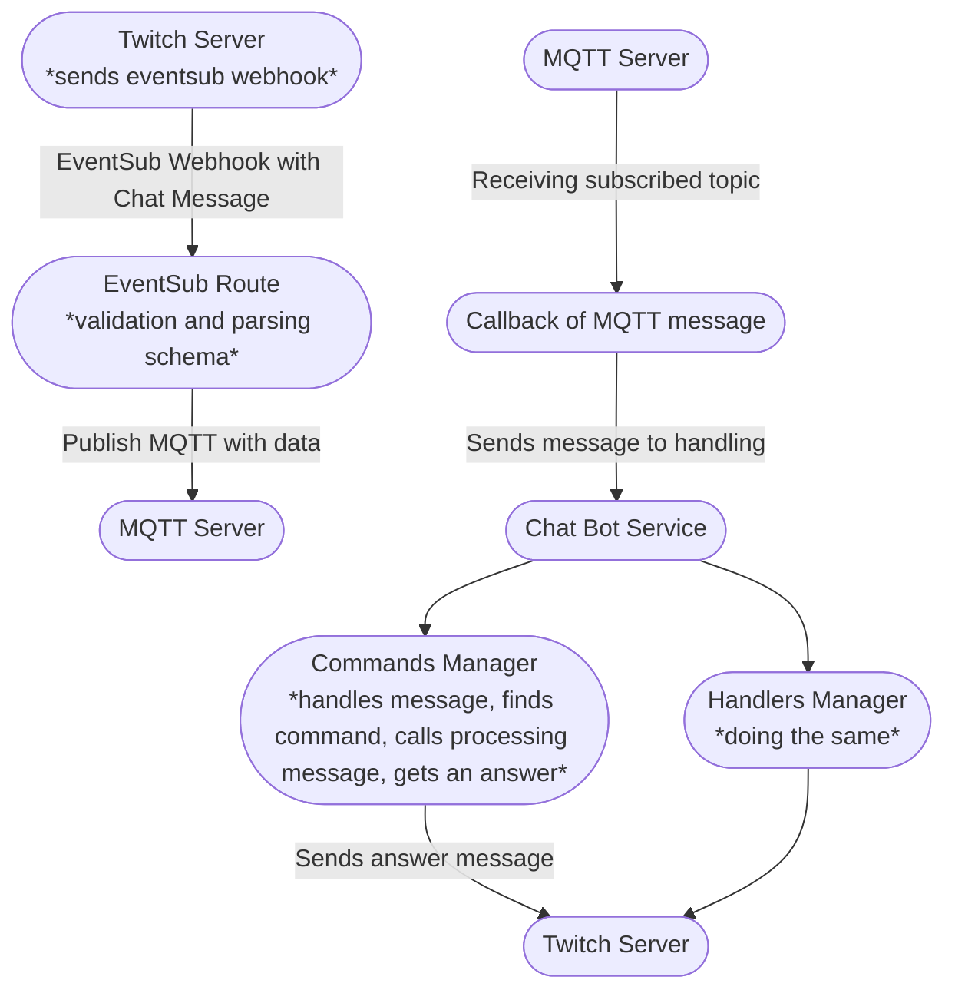

# Message handling



## Разовые CLI-скрипты

### Бэкфилл клипов в Telegram (`scripts/backfill_clips.py`)

Повторная отправка клипов/ярких моментов за период (например, после простоя
TG-сервиса): перезапрашивает клипы за окно у Twitch Helix и шлёт их в clips-чат
теми же payload'ами, что и поллер. Курсоры `last_clip_date`/`last_highlight_date`
не трогает. Дубликаты возможны — истории доставок нет.

Запуск на VDS внутри работающего контейнера (имя контейнера уточни через
`docker ps`; docker cp кладёт скрипт в контейнер без пересборки образа,
при пересоздании контейнера копия пропадёт):

```bash
cd ~/twitch-bot  # папка проекта на сервере
git pull

CONTAINER=$(docker ps -qf "name=app")  # контейнер приложения twitch-bot
docker cp scripts "$CONTAINER":/app/

# 1. Посмотреть, что уйдёт (без отправки, MQTT не подключается):
docker exec -it "$CONTAINER" python -m scripts.backfill_clips \
    --all --from 2026-11-09T00:00:00Z --include-highlights --dry-run

# 2. Боевой прогон (--to = момент восстановления TG-сервиса, чтобы не дублировать клипы после него):
docker exec -it "$CONTAINER" python -m scripts.backfill_clips \
    --all --from 2026-11-09T00:00:00Z --to 2026-11-10T00:00:00Z --include-highlights
```

Вместо `--all` можно перечислить логины: `--login quantum075 d_e_l_y`.
Ключи: `--from`/`--to` — окно по дате создания клипа (ISO, UTC), по умолчанию
`--to` = сейчас; `--include-highlights` — также яркие моменты.
