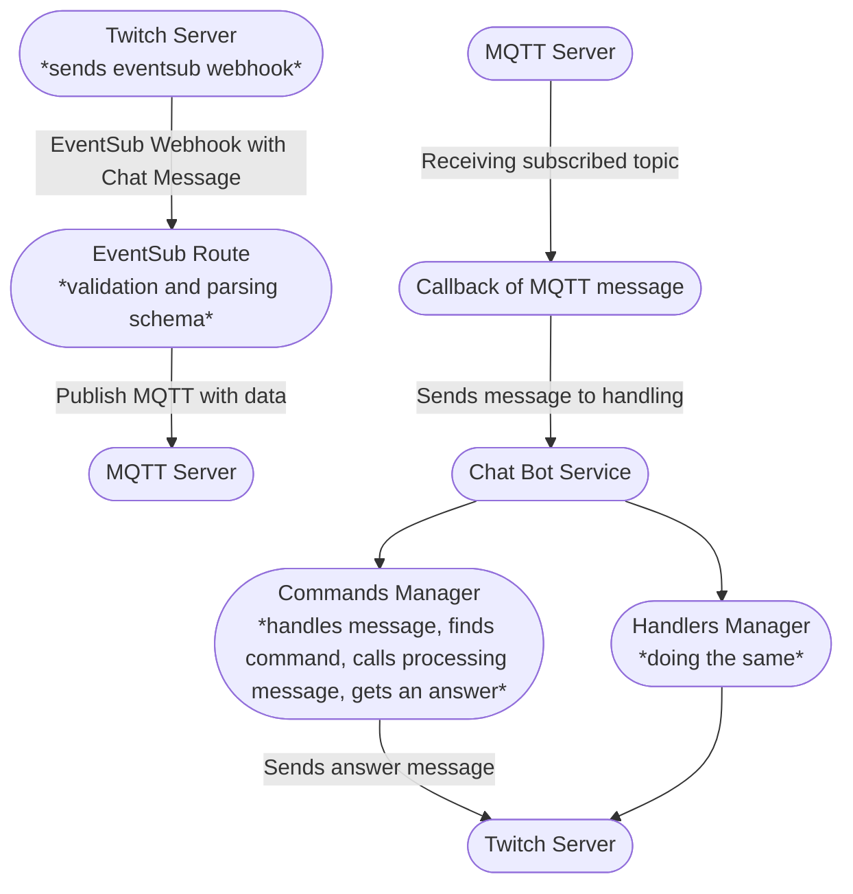

# twitch-bot (bot.quantum0.ru)

Сервис для русскоязычных стримеров Twitch: чат-бот, обмен баллов канала на мемкоины
Memealerts, ИИ-стикеры, TTS, интерактивные оверлеи для OBS и Telegram-уведомления.
Бот работает от аккаунта Quantum075Bot.

Стек: Python 3.11, FastAPI, PostgreSQL (asyncpg + SQLAlchemy 2.x async), Redis,
MQTT/EMQX, APScheduler, Jinja2 + Vanilla JS. Менеджер зависимостей — Poetry.

## Ключевые возможности

Подробное описание каждой фичи — в `docs/<фича>.md` (обзор документации — ниже).

- **Чат-бот** — ~30 интерактивных команд в четырёх категориях (взаимодействия
  между чаттерсами, ссылки, рандомайзеры, другое), кулдауны, запоминаемые
  результаты, авто-шаутаут на рейды — [docs/chatbot.md](docs/chatbot.md).
- **Мемкоины Memealerts** — зритель выкупает награду баллами канала, бот
  начисляет мемкоины саппортеру через API Memealerts —
  [docs/memecoins.md](docs/memecoins.md).
- **ИИ-стикеры** — генерация стикеров по награде (gpt-image), референсы
  персонажей стримеров, галереи — [docs/ai-stickers.md](docs/ai-stickers.md).
- **TTS** (бета) — озвучка чата по награде и триггерам, матрица разрешений,
  модерация текста — [docs/tts.md](docs/tts.md).
- **Оверлеи OBS** — 10+ оверлеев (звёздочка с Heat-кликами, салют, «Найди
  пару», словотрон, яндекс-музыка и др.), события по SSE —
  [docs/overlays.md](docs/overlays.md).
- **Telegram-интеграция** — уведомления о стриме, автозагрузка стикеров и
  клипов — [docs/telegram.md](docs/telegram.md).
- **Система банов** — модерация зрителей по фичам (чат/награды/TTS/сайт),
  канальные и глобальные баны — [docs/bans.md](docs/bans.md).
- **Баланс** — внутренняя валюта стримера для ИИ-фич, история операций —
  [docs/balance.md](docs/balance.md).
- **Социальные фичи** — профиль стримера, лайки, каталог `/streamers` с
  фильтрами и нечётким поиском — [docs/social.md](docs/social.md).
- **Ачивки** — достижения стримеров за действия на сайте и в Twitch,
  условия скрыты, панель на профиле — [docs/achievements.md](docs/achievements.md).
- **Twitch-расширение** — интерактивная «визуальная новелла» о сервисе —
  [docs/extension.md](docs/extension.md).
- **Согласия (ФЗ-152)** — юрдокументы, cookie-баннер, гейтинг Яндекс.Метрики —
  [docs/consent.md](docs/consent.md).
- **Мониторинг** — статистика сервиса `/stats`, карта потоков `/flowviz`,
  метрики хоста `/server` — [docs/monitoring.md](docs/monitoring.md).

Устройство приложения (компоненты, жизненный цикл, фоновые джобы) —
[docs/architecture.md](docs/architecture.md); прод-сервер и бэкапы —
[docs/infrastructure.md](docs/infrastructure.md).

## Схема обработки сообщений



## Структура проекта

```
main.py                  # FastAPI entry point, роутеры, lifespan
container.py             # DI-контейнер и wiring_config
dependencies.py          # get_db, lifespan, get_container
database/models.py       # SQLAlchemy-модели
routers/
    routers.py           # сборка api_router и user_router
    web/                 # HTML-страницы и оверлеи
    api/                 # JSON-API (user_api, extension, eventsub, slovotron, user/*)
services/                # бизнес-логика (cache, mqtt, twitch, statistics, sse_manager, ...)
twitch/chat/             # чат-бот (bot.py, command_manager.py, commands/, handlers/)
schemas/                 # Pydantic-схемы
utils/                   # хелперы (streamers, streamers_sort, overlays, enums)
templates/               # Jinja2-шаблоны
static/                  # CSS, JS (streamers.js, stats.js, heat-ws.js, ui/)
```

## Разработка

```bash
poetry install                              # зависимости
poetry run uvicorn main:app --reload        # дев-сервер
poetry run pytest                           # тесты (unit + front; e2e — маркер e2e)
poetry run ruff check . && poetry run mypy  # линтер и типы
```

Правила работы с репозиторием (запреты, тесты, готчи, миграции БД) —
[AGENTS.md](AGENTS.md). История изменений — [CHANGELOG.md](CHANGELOG.md).
